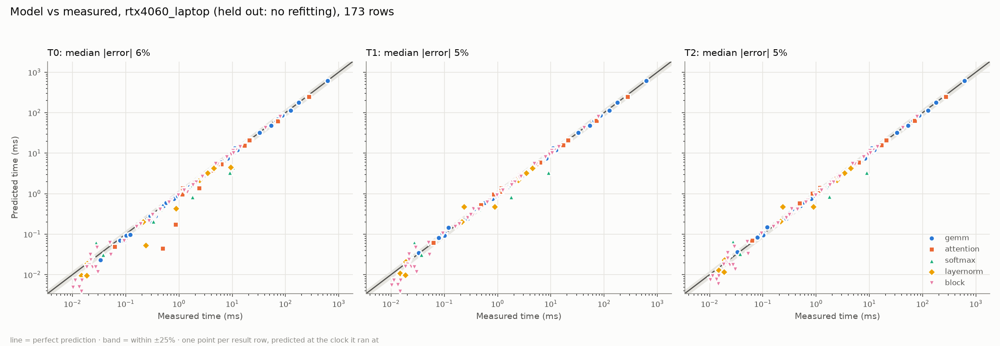
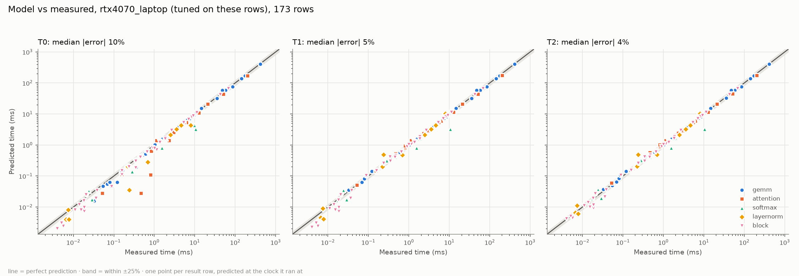

# The performance model: does it generalize from the 4070 to the 4060?

`model/` predicts each kernel's runtime from the GPU's measured ceilings (`specs/<gpu>.json`), its
launch shape and resource use, and a descriptor that counts work and traffic from the kernel's
index math. It is tuned on the RTX 4070 Laptop only and then predicts the RTX 4060 Laptop with no
refitting (D1). Same memory system, 36 vs 24 SMs: compute-bound kernels must come out ~1.5x
apart and memory-bound ones about equal.

```sh
python -m model predict gemm v3 4096x4096x4096 --gpu rtx4060_laptop   # one kernel, per-launch breakdown
python -m model validate --gpu rtx4060_laptop                          # held-out error table
python -m model block --gpu rtx4070_laptop                             # transformer block (D4)
python -m model tune                                                   # refit params.json on 4070 rows
python -m model plots                                                  # analysis/plots/model_<gpu>.png
```

## How it predicts

Each descriptor (`model/kernels/`) turns a kernel, variant and shape into launches, and for each
launch counts: FLOPs it executes (including zero-padded tile work), DRAM bytes, L1<->L2 bytes,
shared-memory wavefronts, global and shared load/store instructions, and L1 wavefronts. DRAM bytes
come from an L2 model (`model/l2.py`): data a call touches stays in L2 across the bench's
back-to-back repeats when it fits, and tiled GEMMs reuse A and B panels by reuse distance, counted
per wave for the lockstep `__syncthreads` kernels (v2-v4) and per block for the free-running v0/v1.
The tiers (D2) then add effects one at a time:

| tier | adds | captures |
|---|---|---|
| T0 | roofline over every measured ceiling (FP32/tensor peak, DRAM, L2, shared memory) and the load/store issue limits | which unit bounds the kernel |
| T1 | occupancy (checked against ncu on all 82 launch shapes) and per-SM rounds: the busiest SM's blocks, in rounds of at most blocks-per-SM, each round at min(1, warps / sat_warps) of the SM's rate | partial waves, grids smaller than the GPU, small blocks |
| T2 | Little's law (bytes in flight vs DRAM/L2 latency from the pointer chase) and a per-launch overhead | latency-bound memory streams, launch-dominated small calls |

Every prediction is made at the SM and memory clock its result row recorded (D7): compute, L2,
shared memory and the LSU scale with the SM clock, DRAM with the memory clock.

### Parameters tuned on the 4070 (`model/params.json`)

Coordinate descent over a grid, minimizing mean |log(predicted / measured)| at T2 (each row's
contribution capped at 3x) over the 173 rows the 4070 suite produced.

| parameter | value | meaning |
|---|---|---|
| `l2_eff` | 0.85 | usable fraction of the 32 MB L2 for reuse |
| `launch_us` | 2.0 | GPU time per back-to-back launch |
| `ldg_per_clk` | 0.5 | global load/store instructions per SM per cycle (ncu: `lg_throttle`) |
| `lds_per_clk` | 0.65 | shared load/store instructions per SM per cycle (ncu: `mio_throttle`) |
| `narrow_eff` | 0.3 | DRAM efficiency of isolated 32 B sector reads from far-apart rows |
| `fma_eff` | 0.625 | fraction of the FMA microbenchmark's peak a GEMM inner loop sustains |
| `tc_eff` | 0.425 | the same for the WMMA loop |
| `sat_warps` | 12 | resident warps an SM needs to run at full rate |

Everything else is measured (ceilings, latencies, clocks) or counted (descriptors).

## Results



### RTX 4060 Laptop, held out

The full suite from `b/model-inputs` (#12), predicted with the 4070's parameters and no refitting.

| kernel | variant | rows | T0 median abs err | T1 median abs err | T2 median abs err | T2 bias | T2 worst row |
|---|---|---|---|---|---|---|---|
| attention | v1 | 5 | 42% | 6% | 5% | 1.04 | 12x512x64 +18% |
| attention | v2 | 5 | 5% | 2% | 2% | 1.06 | 12x1024x64 +19% |
| block | attn | 5 | 5% | 5% | 2% | 1.07 | 8x512x768x12 +21% |
| block | fc1 | 5 | 6% | 6% | 6% | 1.02 | 8x512x768x12 +10% |
| block | fc2 | 5 | 5% | 5% | 5% | 1.00 | 1x512x768x12 +20% |
| block | gelu | 5 | 11% | 11% | 11% | 0.93 | 1x512x768x12 -26% |
| block | ln1 | 5 | 40% | 45% | 27% | 1.10 | 4x1024x768x12 +61% |
| block | ln2 | 5 | 37% | 41% | 43% | 1.04 | 1x512x768x12 -43% |
| block | merge | 5 | 41% | 41% | 37% | 0.63 | 1x512x768x12 -60% |
| block | proj | 5 | 4% | 4% | 4% | 0.98 | 1x512x768x12 +14% |
| block | qkv | 5 | 5% | 5% | 5% | 0.96 | 8x512x768x12 -8% |
| block | res1 | 5 | 36% | 36% | 18% | 1.19 | 4x1024x768x12 +69% |
| block | res2 | 5 | 51% | 51% | 38% | 1.15 | 4x1024x768x12 +75% |
| block | split | 5 | 4% | 4% | 3% | 0.84 | 1x512x768x12 -54% |
| block | total | 5 | 1% | 1% | 2% | 1.00 | 1x512x768x12 -5% |
| gemm | v0 | 13 | 3% | 3% | 3% | 0.99 | 512x3072x768 +21% |
| gemm | v1 | 13 | 2% | 2% | 2% | 0.97 | 512x2304x768 -5% |
| gemm | v2 | 13 | 5% | 5% | 4% | 0.95 | 3072x3072x3072 -10% |
| gemm | v3 | 13 | 8% | 5% | 5% | 0.99 | 512x768x3072 +16% |
| gemm | v4 | 13 | 6% | 4% | 6% | 1.01 | 512x768x3072 +23% |
| layernorm | v0 | 3 | 52% | 46% | 46% | 1.06 | 1024x768 +103% |
| layernorm | v1 | 3 | 4% | 5% | 4% | 1.04 | 1024x768 +22% |
| layernorm | v2 | 3 | 6% | 6% | 6% | 0.93 | 1024x768 -13% |
| layernorm | v3 | 3 | 12% | 12% | 11% | 0.81 | 1024x768 -37% |
| softmax | v0 | 4 | 55% | 29% | 28% | 0.64 | 24576x2048 -63% |
| softmax | v1 | 4 | 6% | 6% | 5% | 1.19 | 6144x512 +134% |
| softmax | v2 | 4 | 7% | 7% | 7% | 1.04 | 6144x512 +42% |
| softmax | v3 | 4 | 10% | 10% | 10% | 0.90 | 6144x512 -11% |
| **all** |  | 173 | 6% | 5% | 5% | 0.98 | 24576x2048 -63% |

**Does it get the SM scaling right?** D1's test is the 4060 / 4070 time ratio: about 1.5x for
compute-bound kernels, about 1x for memory-bound ones. Medians over the rows both GPUs share
(block: the total only):

| kernels | rows | measured 4060 / 4070 | predicted | median abs error of the ratio |
|---|---|---|---|---|
| GEMM v0-v4 | 61 | 1.48 | 1.47 | 2% |
| GEMM v3/v4 at 512x768x768 and 512x768x3072 (24 tiles: one wave on both GPUs) | 4 | 1.02 | 0.99 | 4% |
| softmax / LayerNorm | 28 | 0.98 | 1.00 | 4% |
| attention | 15 | 1.06 | 1.00 | 4% |
| block total | 5 | 1.24 | 1.22 | 1% |

The one-wave GEMMs are T1's case: the 4070's extra 12 SMs sit idle, so they run at the same
speed on both GPUs, and a roofline alone would have predicted 1.5x.

**Where it misses on the 4060.** The block's small steps (residual adds, LayerNorms, split/merge
at 512-1024 tokens, 10-50 us each) take 5-10 us longer on the 4060 than on the 4070, yet match
at 8x2048. That is per-launch overhead: the 4060 runs under WSL2, the 4070 natively, and
`launch_us` = 2 us was fitted on native Linux. Those rows give the 4060's worst block-step
errors (residual 4x1024 +69%) without moving the block total, where they are under 1% of the
time.

### RTX 4070 Laptop, tuning set



| kernel | variant | rows | T0 median abs err | T1 median abs err | T2 median abs err | T2 bias | T2 worst row |
|---|---|---|---|---|---|---|---|
| attention | v0 | 5 | 15% | 10% | 10% | 0.93 | 12x4096x64 -14% |
| attention | v1 | 5 | 40% | 4% | 4% | 1.09 | 12x512x64 +25% |
| attention | v2 | 5 | 20% | 2% | 1% | 1.06 | 12x1024x64 +21% |
| block | attn | 5 | 5% | 5% | 1% | 1.03 | 8x512x768x12 +12% |
| block | fc1 | 5 | 3% | 1% | 2% | 1.03 | 1x512x768x12 +10% |
| block | fc2 | 5 | 15% | 4% | 4% | 1.03 | 1x512x768x12 +23% |
| block | gelu | 5 | 10% | 10% | 9% | 0.85 | 1x512x768x12 -34% |
| block | ln1 | 5 | 11% | 11% | 6% | 1.01 | 8x2048x768x12 -11% |
| block | ln2 | 5 | 11% | 11% | 5% | 1.01 | 8x2048x768x12 -11% |
| block | merge | 5 | 47% | 46% | 37% | 0.69 | 4x1024x768x12 -41% |
| block | proj | 5 | 11% | 1% | 1% | 1.06 | 1x512x768x12 +21% |
| block | qkv | 5 | 1% | 1% | 2% | 0.99 | 1x512x768x12 -5% |
| block | res1 | 5 | 15% | 15% | 7% | 1.09 | 4x1024x768x12 +30% |
| block | res2 | 5 | 12% | 12% | 7% | 1.09 | 8x512x768x12 +32% |
| block | split | 5 | 11% | 11% | 11% | 0.81 | 1x512x768x12 -50% |
| block | total | 5 | 4% | 1% | 1% | 1.00 | 1x512x768x12 -3% |
| gemm | v0 | 13 | 3% | 2% | 2% | 0.98 | 4096x2304x768 -3% |
| gemm | v1 | 13 | 2% | 1% | 1% | 1.01 | 3072x3072x3072 +23% |
| gemm | v2 | 13 | 2% | 2% | 2% | 0.97 | 4096x4096x4096 -11% |
| gemm | v3 | 13 | 10% | 3% | 3% | 1.03 | 512x768x3072 +22% |
| gemm | v4 | 13 | 12% | 5% | 4% | 1.00 | 512x768x3072 +18% |
| layernorm | v0 | 3 | 59% | 30% | 30% | 1.22 | 1024x768 +104% |
| layernorm | v1 | 3 | 7% | 7% | 7% | 1.09 | 1024x768 +50% |
| layernorm | v2 | 3 | 9% | 9% | 4% | 0.95 | 4096x16384 -9% |
| layernorm | v3 | 3 | 13% | 13% | 13% | 0.86 | 1024x768 -21% |
| softmax | v0 | 4 | 53% | 30% | 30% | 0.66 | 24576x2048 -69% |
| softmax | v1 | 4 | 13% | 13% | 13% | 1.01 | 6144x512 +50% |
| softmax | v2 | 4 | 10% | 9% | 9% | 0.94 | 12288x1024 -10% |
| softmax | v3 | 4 | 13% | 13% | 13% | 0.82 | 6144x512 -32% |
| **all** |  | 173 | 10% | 5% | 4% | 0.98 | 24576x2048 -69% |

## Which effect explains which error

- **Occupancy and waves (T0 -> T1)**: attention v1 drops from 40% to 4% on the 4070, and from 42% to 6% held out on the 4060. It runs one
  `gemm_v3` per head, and at N = 256 a head's Q·Kᵀ is 4 tiles: 32 of 36 SMs sit idle, which T0's
  "spread evenly over all SMs" cannot see. The block's `fc2` at 512 tokens is the same effect in a
  single launch: 24 blocks on 36 SMs, each SM holding one 8-warp block that runs at
  8 / sat_warps of its rate (+15% -> +4%).
- **Launch overhead and latency (T1 -> T2)**: the block's residual adds and LayerNorms (15% ->
  7%, 11% -> 6%) are a few microseconds each, where 2 us per launch is a large share.
- **Narrow DRAM sectors (all tiers)**: attention's P·V reads the N×N probabilities through
  `gemm_v3`'s 128×8 A tile, 32 B per row per step from rows 8-16 KB apart. Counted as streaming
  traffic the model was 30% fast on attention v2 and the block's attention step; with
  `narrow_eff` both fall to 1-2%. This is also why `analysis/attention.md` predicted a 1.1-1.25x
  4070 speedup for attention and measured 0.97x at N = 4096 (20.95 vs 20.32 ms): P·V is
  DRAM-bound on both GPUs, not compute-bound, so it does not scale with SMs.

## Failure analysis

| case | worst error | why the model misses it |
|---|---|---|
| softmax / LayerNorm v0 (one thread per row) | -69% (softmax 24576x2048), +104% (LayerNorm 1024x768) | Each warp access touches 32 rows. Whether those lines survive in L1 until the next 7 columns use them depends on how many rows each SM holds, so the real traffic sits anywhere between 1x and 8x the counted one. The model counts wavefronts and DRAM passes but not L1 thrashing. |
| small calls (softmax v1 6144x512, LayerNorm v1 1024x768) | +50% | Tens of microseconds, L2-resident: launch overhead and tail effects dominate, and one fitted `launch_us` cannot cover kernels whose launch cost differs. |
| bank conflicts | GEMM v2 -11% at 4096³ | v2 has 35M conflicts (<1% of shared accesses) and v4's WMMA fragment loads some more; the descriptors assume conflict-free layouts. Small effect here. |
| instruction-level efficiency | absorbed by `fma_eff` = 0.625, `tc_eff` = 0.425 | GEMM v3 reaches 62% of the FMA microbenchmark (register bank conflicts, address math, barriers) and v4 42% of the mma microbenchmark (WMMA fragment loads through shared memory). The model cannot derive those from first principles; it fits one number per pipe on the 4070 and carries it to the 4060 unchanged. |
| L2 reuse | GEMM v1 3072³ +23% | The panel model is all-or-nothing at `l2_eff` x 32 MB. Shapes whose reuse distance sits near that edge (v1 at 3072: 384 KB panels, 96 per row) get partial reuse in reality. |
| clock variance | no row error, by construction | Predictions use each row's measured clock. The model does not predict the clock: under sustained FMA load the 4070 drops from 2490 to 1700-2000 MHz (cuBLAS, v3 at 4096³), so a prediction at the ceiling clock would be up to 1.4x optimistic for those rows. |
| launch overhead per platform | residual 4x1024 +69%, softmax v1 6144x512 +134% (4060; +30% and +50% on the 4070) | `launch_us` is one number fitted on the native-Linux 4070. Under WSL2 the 4060 pays 5-10 us more per small launch, so 10-50 us kernels come out slow there. A per-platform launch term would fix it, but fitting it on the 4060 would break D1. |
| elementwise index math | split -50%, merge -41% (small shapes) | Integer division is counted as a fixed 40 instructions per element; the real cost depends on what the compiler hoists. |

## Transformer block (D4)

GPT-2 small layer (d = 768, 12 heads), FP32, `block/block.cu`. The model column is the sum of the
model's per-step predictions; "measured total" runs all twelve steps back to back.

On the 4070 Laptop:

| B×S×D×H | measured total | measured Σ steps | model Σ steps T0 | T1 | T2 | T2 vs total | PyTorch eager | PyTorch graph | ours vs eager |
|---|---|---|---|---|---|---|---|---|---|
| 1x512x768x12 | 1.151 | 1.038 | 0.716 | 1.104 | 1.134 | -1% | 1.091 | 1.110 | 0.95× |
| 1x2048x768x12 | 8.186 | 8.404 | 8.036 | 8.413 | 8.443 | +3% | 9.877 | 9.871 | 1.21× |
| 4x1024x768x12 | 11.271 | 11.644 | 11.443 | 11.753 | 11.783 | +5% | 14.335 | 13.209 | 1.27× |
| 8x512x768x12 | 9.143 | 9.070 | 8.855 | 9.167 | 9.197 | +1% | 10.602 | 10.021 | 1.16× |
| 8x2048x768x12 | 67.636 | 69.669 | 68.963 | 69.288 | 69.318 | +2% | 81.224 | — (out of memory) | 1.20× |

On the 4060 Laptop, held out:

| B×S×D×H | measured total | measured Σ steps | model Σ steps T0 | T1 | T2 | T2 vs total | PyTorch eager | PyTorch graph | ours vs eager |
|---|---|---|---|---|---|---|---|---|---|
| 1x512x768x12 | 1.428 | 1.330 | 1.084 | 1.294 | 1.324 | -7% | 1.508 | 1.564 | 1.06× |
| 1x2048x768x12 | 9.432 | 9.483 | 9.315 | 9.317 | 9.347 | -1% | 11.560 | 11.423 | 1.23× |
| 4x1024x768x12 | 13.962 | 13.509 | 14.035 | 14.037 | 14.067 | +1% | 16.448 | 16.485 | 1.18× |
| 8x512x768x12 | 11.553 | 11.290 | 11.756 | 11.758 | 11.788 | +2% | 12.909 | 12.874 | 1.12× |
| 8x2048x768x12 | 78.111 | 78.699 | 79.921 | 79.921 | 79.951 | +2% | 96.315 | — (out of memory) | 1.23× |

Per step at 8x2048x768x12, 4070:

| step | measured | model T2 | error | limiter |
|---|---|---|---|---|
| ln1 | 0.4538 | 0.4060 | -11% | dram |
| qkv | 5.3012 | 5.3469 | +1% | compute |
| split | 1.3647 | 1.2138 | -11% | dram |
| attn | 42.6250 | 42.6243 | -0% | dram |
| merge | 0.4610 | 0.4059 | -12% | dram |
| proj | 1.8647 | 1.8527 | -1% | compute |
| res1 | 0.6560 | 0.6079 | -7% | dram |
| ln2 | 0.4540 | 0.4060 | -11% | dram |
| fc1 | 6.9356 | 7.1842 | +4% | compute |
| gelu | 1.8476 | 1.6178 | -12% | dram |
| fc2 | 7.0492 | 7.0450 | -0% | compute |
| res2 | 0.6561 | 0.6079 | -7% | dram |

The sum of predicted steps lands within 5% of the measured block at every size on the 4070,
and within 7% on the held-out 4060 (2% or better from 2048 tokens up). Attention is
61% of the block at 8x2048 and DRAM-bound, so that is where an unfused FP32 block goes.
On the 4070, PyTorch eager (SDPA math backend) is 16-27% slower than ours from 2048 tokens up,
and 5% faster at 512 tokens, where per-launch costs dominate both. On the 4060 it is 6-23%
slower at every size.
